# The Human Mirror: Database Design

Schema `mirror` in the 2nd Chance Supabase project (D-07). UUID primary keys (`gen_random_uuid()`), `created_at` /
`updated_at timestamptz` on every table, `numeric(12,2)` for money, text check-constraints instead of enums (easier to extend
in a migration). Every schema change is a migration in `supabase/migrations/` named `*_mirror_*.sql`; each migration that
creates a table also grants it (CLAUDE.md, Supabase change 10/30/2026): `service_role` all, nobody else.
No giant table: one person has many small records. History is kept: answers and financial snapshots are append-only.

## 1. Tables by group

### Identity and organizations
| Table | Key columns | Notes |
|---|---|---|
| organizations | name, kind (nonprofit, agency, other), active | 2nd Chance Housing is the first row. |
| organization_members | organization_id, auth_email, name, role (org_admin, coordinator, volunteer), active, invited_at, joined_at | Unique (organization_id, lower(auth_email)). |
| profiles | auth_email (unique), display_name, language, text_size, notification_prefs jsonb | Any signed-in Mirror user, individual or member. |
| individuals | auth_email (unique, nullable: coordinator-assisted people may have no email), preferred_name, legal_name, birth_year (optional), created_by_org, deletion_requested_at | Minimal identity; everything else is an answer. No SSN, no ID numbers (data minimization). |
| organization_individuals | organization_id, individual_id, status (invited, active, ended), started_on, ended_on, primary_coordinator | Which organizations the person works with. Isolation key. |
| consents | individual_id, organization_id, category, access (view, edit), granted_at, granted_by, expires_on, revoked_at | One row per grant; revoking keeps the row (history). |

### Assessment engine (8 perspectives, 15 dimensions, functional, modules)
| Table | Key columns | Notes |
|---|---|---|
| reflections | key (identity, history, vision, assets, needs, function, preferences, contribution), title, question, sort | The 8 perspectives (seed). |
| dimensions | key, number 1-15, title, intro | The 15 life dimensions (seed). |
| question_sets | key, kind (reflection, dimension, functional, module), reflection_id, dimension_id, version, active | A questionnaire as data. |
| reflection_questions | set_id, key, prompt, help, answer_type, options jsonb, sensitive_category, sort, active | Spec name kept; holds the questions of every set. answer_type: text, long_text, choice, multi, yes_no, number, money, date, rating. |
| assessments | individual_id, set_id, set_version, organization_id (null when done alone), started_at, completed_at, conducted_by | One sitting or one ongoing questionnaire; save and return. |
| assessment_responses | assessment_id, question_id, value jsonb, state (answered, unknown, not_applicable, prefer_not, needs_help), note, answered_by, answered_at, superseded_at | Append-only: changing an answer supersedes the old row. |
| reflection_answers | (view) | Current answers for sets of kind reflection, per individual. |
| functional_assessments | individual_id, organization_id, assessed_by, assessed_by_role, is_self_report, started_at, completed_at, professional_review_needed, review_note, review_by_role, review_at | One check-in (built 11/13, migration 20261119300000). One open check-in per person for self and one for helpers; a finished one never changes (trigger); the review mark is set only by a helper. No assessment_id: the 11 areas are answered through the question engine. |
| adl_assessments | functional_assessment_id, activity (bathing, dressing, transferring, eating, toileting, continence), level (independent, with_device, some_help, full_help, not_assessed), preference, note | |
| iadl_assessments | functional_assessment_id, activity (meal_prep, shopping, medication, finances, transportation, housekeeping, laundry, devices), level, preference, note | The other 11 functional areas are question sets of kind functional. |

### Needs, strengths, development
| Table | Key columns | Notes |
|---|---|---|
| needs | individual_id, dimension_id, title, detail, urgency (urgent, soon, later), status (identified, planning, in_progress, obtained, verified, no_longer_needed), sensitive_category, identified_by, verified_at, verified_by | Every need its own record (Mirror1 Part 2). |
| need_events | need_id, at, by, from_status, to_status, note | Lifecycle history (state ID example in Mirror1 Part 4). |
| strengths | individual_id, dimension_id (nullable), kind (skill, talent, experience, credential, language, interest, relationship), title, detail | Strengths inventory beside the needs inventory. |
| goals | individual_id, dimension_id, title, stage (1-6 journey stages), target_date, status, set_by_individual | The person chooses; stages are not deadlines. |
| action_plans | individual_id, title, status | |
| action_items | action_plan_id, need_id, goal_id, title, assigned_member_id, assigned_to_self, due_on, status, done_at | |
| milestones | individual_id, goal_id, title, achieved_on, verified_by | Accomplishments. |

### Daily Number
| Table | Key columns | Notes |
|---|---|---|
| expense_categories | key, title, sort | 12 seed categories: housing, utilities, food, transportation, healthcare, personal care, clothing, communication, household, financial, personal development, future security. |
| living_expenses | individual_id, level (survival, stability, aspirational), category_id, label, amount, frequency, times_per_year, paid_by (self, subsidy, assistance, donated, other), active, start_on, end_on | `paid_by` keeps "total cost" apart from "cash I pay". |
| income_sources | individual_id, kind (wages, self_employment, cash_benefit, pension, family_support, other), label, amount, frequency, is_gross, active | Cash only. |
| noncash_resources | individual_id, kind (snap, housing_subsidy, healthcare_coverage, donated_goods, donated_services, other), label, est_value, frequency, active | Never added to cash income (prompt Part 4). |
| financial_goals | individual_id, kind (emergency_reserve, savings, debt_payoff, retirement, purchase), target_amount, current_amount, target_date | Savings and emergency reserves. |
| daily_number_snapshots | individual_id, taken_at, method_version, inputs jsonb, results jsonb, note, taken_by | Immutable. results = the 7 distinguished figures below, per level. |

The 7 figures (prompt Part 4), computed by one function `mirror.daily_number(individual_id)` and mirrored in `daily-number.js`:
1 total cost of living (all expenses), 2 cash paid by the person (`paid_by = self`), 3 paid through subsidy or assistance,
4 noncash support value, 5 cash income available, 6 shortfall = max(0, cash paid - cash income), 7 gross income needed =
(cash paid) / (1 - effective tax rate entered by the person or coordinator; none assumed). All per day, week, month, year (D-08).
Also the "cost of being poor" lines (Daily Number paper section 7) as optional `living_expenses` tagged `poverty_premium`.

### Housing
| Table | Key columns |
|---|---|
| housing_options | key (independent, supported_independent, assisted, skilled_nursing, accessible, permanent_supportive, other_specialized), title, description (seed) |
| housing_profiles | individual_id (primary key), current_arrangement, current_note, preferred_option_ids uuid[], barriers jsonb {keys, note}, accessibility_needs jsonb {keys, note} (topic health), professional_review_needed, review_note, review_by_role, review_at, updated_by_role |
| housing_history | individual_id, from_on, to_on, arrangement, city, note, sensitive_category (health, mental_health, safety, legal; nullable), created_by_role. Arrangements care_setting and hospital_treatment are topic health, jail is legal (built 11/13). |

### Resources and coordination (reuse CHPMS: D-11)
| Table | Key columns | Notes |
|---|---|---|
| (public) chpms_orgs, chpms_programs, chpms_eligibility | existing | = providers, resources, eligibility_rules. Read through existing functions. |
| resource_categories | chpms_program_id, dimension_key, expense_category_key, source (rule, office), note, added_by | Links a program to life dimensions and to the Daily Number costs it can lower. `rule` rows come from the CHPMS help types through `resource_assist_map` (assist_category, dimension_key, expense_category_key) and are rebuilt on every import; `office` rows are kept (T7.1, 11/13/2026). |
| resource_suggestions | individual_id, chpms_program_id, program_name, org_name, need_id, dimension_key, category, status (suggested, eligibility_confirmed, applied, enrolled, declined), status_note, confirmed_by, confirmed_by_role, confirmed_at, source (match, coordinator), added_by, added_by_role | Suggested is never shown as eligible (Part 11): a check keeps confirmed_at empty while suggested. History in resource_suggestion_events; the person's place and groups in resource_profiles (self only). T7.2, migration 20261119410000. |
| referrals | individual_id, organization_id, suggestion_id, chpms_org_id, chpms_program_id, org_name, program_name, category, status (awaiting_consent, consented, referred, declined, withdrawn), help_needed, note_to_program, proposed_by(_role), first_name, last_name, share_email, share_phone, household_size, consent_name, consent_text, consent_at, chpms_referral_id, referred_by, referred_at | The person types consent on their own page (no separate consent row: the typed name and the exact words are kept on the referral); made through public.chpms_referral_save; history in referral_events (T7.3, migration 20261119413000, D-33). |
| services | organization_id, name, description, dimension_key, category, active, created_by | What the organization itself provides; organization admins keep it (T8.4, migration 20261119540000, D-34). |
| service_enrollments | individual_id, service_id, organization_id, category, status (active, paused, completed, ended), started_on, ended_on, note, enrolled_by(_role) | One open per person and service; history in service_enrollment_events (from/to status, note, by role). |
| appointments | individual_id, organization_id (null = the person's own), dimension_key, category, title, starts_at, ends_at, place, with_whom, detail, status (scheduled, done, cancelled, not_happened), created_by(_role) | History in appointment_events. Reminders come with Phase 9 (T9.2). T8.5, migration 20261119550000, D-35. |
| interactions | individual_id, organization_id, category, kind (visit, call, message, meeting, other), at, summary, corrects, by_email, by_name, by_role | Contact notes. Append-only (a correction is a new note); the person sees every note (D-35). |
| benefit_applications | not a separate table: mirror.benefit_records (Phase 4) holds program, kind, agency, status, applied_on, approved_on, renewal_on, appeal_by, ends_on | Mirror1 Part 5B. Organizations read it through mirror_benefits and the dashboard through mirror_benefit_dates (T8.6, D-37). |
| inventory_items | organization_id, category, item, size, fits, condition, season, quantity, location, note, active | Donated goods (Clothes paper section 12). T8.7, migration 20261119570000, D-38. |
| inventory_given | item_id, organization_id, individual_id (null = not in the Mirror, no name), quantity, given_on, note, given_by(_role), returned_at, returned_note | A mistake is marked returned; the person sees what they received. |

### Documents and governance
| Table | Key columns | Notes |
|---|---|---|
| nav_referrals.mirror_individual_id (public) | -> mirror.individuals (on delete set null) | A Navigator person's Human Mirror (TN.2, migration 20261119620000); the Navigator business is a Mirror organization (mirror.navigator_org). |
| nav_followups.mirror_need_id (public) | -> mirror.needs (on delete set null) | A Navigator check-in linked to a Mirror need, set only in the Mirror (TN.5, migration 20261119650000). |
| nav_whole_consents (public) | nav_referral_id, topics (category -> none/view/edit), consent_name, consent_text, version, recorded_by(_role), signed_at, replaced_at, withdrawn_on | Navigator person's sharing beyond housing (TN.1, migration 20261119610000, D-36); copied into mirror.consents by mirror.nav_whole_consent_to_mirror when TN.2 links the person. |
| document_types | key (state_id, birth_certificate, social_security_card, insurance_card, income_proof, benefit_letter, lease, other), label, category (all documents today), has_expiry, sort | Seed (T7.4, migration 20261119414000). |
| documents | individual_id, type_key, title, file_name, mime, size_bytes, storage_path (<individual>/<document id>), expires_on, location_note, uploaded_by(_role), organization_id | Files in private bucket `mirror-docs` (no storage policy), only through edge function mirror-files: one-time upload links and 5-minute open links after the gate. Shown only once the file exists; details without a file cleared after a day. No document numbers stored. When a row goes away while its file exists (a person removed), the path is queued in document_removals and the hourly job mirror-docs-sweep removes the file through mirror-files (migration 20261119415000). |
| role_permissions | role, category, action (view, edit) | The access matrix as data (SECURITY_PLAN.md). |
| audit_logs | at, actor_email, actor_role, organization_id, individual_id (no FK), action, table_name, row_id, category | Append-only, never deleted with the person (ids only, no content). |
| notifications | recipient_email, individual_id, kind, ref, status (held, queued, skipped), reason, outbox_id, created_at | Every Mirror email attempt (T9.1, migration 20261119660000); outbox_id links to `public.email_outbox` when queued. No words stored. |

## 2. Relationships, deletion and indexes

- Every person-owned table has `individual_id uuid not null references mirror.individuals on delete cascade` and an index on it.
  Deleting a person (after the D-18 hold) removes all their records in one statement; `audit_logs` keeps the bare id.
- `organization_id references mirror.organizations on delete restrict` (an organization with people cannot be dropped).
- `assigned_member_id references organization_members on delete set null`.
- Partial indexes on open work: `needs (individual_id) where status not in ('verified','no_longer_needed')`,
  `action_items (assigned_member_id, due_on) where status <> 'done'`, `consents (individual_id, organization_id) where revoked_at is null`.
- Check constraints for every status/kind list, `amount >= 0`, `times_per_year > 0` when frequency is irregular.

## 3. Relationship diagram

```mermaid
erDiagram
  organizations ||--o{ organization_members : has
  organizations ||--o{ organization_individuals : serves
  individuals ||--o{ organization_individuals : "works with"
  individuals ||--o{ consents : grants
  organizations ||--o{ consents : receives
  question_sets ||--o{ reflection_questions : contains
  reflections ||--o{ question_sets : "perspective of"
  dimensions ||--o{ question_sets : "dimension of"
  individuals ||--o{ assessments : takes
  assessments ||--o{ assessment_responses : records
  reflection_questions ||--o{ assessment_responses : answers
  individuals ||--o{ functional_assessments : has
  functional_assessments ||--o{ adl_assessments : rates
  functional_assessments ||--o{ iadl_assessments : rates
  individuals ||--o{ needs : has
  needs ||--o{ need_events : history
  individuals ||--o{ strengths : has
  individuals ||--o{ goals : sets
  individuals ||--o{ action_plans : owns
  action_plans ||--o{ action_items : contains
  needs ||--o{ action_items : "worked by"
  goals ||--o{ milestones : marks
  individuals ||--o{ living_expenses : lists
  expense_categories ||--o{ living_expenses : groups
  individuals ||--o{ income_sources : has
  individuals ||--o{ noncash_resources : receives
  individuals ||--o{ daily_number_snapshots : saves
  individuals ||--o{ financial_goals : sets
  individuals ||--|| housing_profiles : has
  individuals ||--o{ housing_history : lived
  individuals ||--o{ resource_suggestions : gets
  individuals ||--o{ referrals : has
  consents ||--o{ referrals : authorizes
  organizations ||--o{ services : provides
  services ||--o{ service_enrollments : enrolls
  individuals ||--o{ appointments : has
  individuals ||--o{ interactions : has
  individuals ||--o{ benefit_applications : files
  organizations ||--o{ inventory_items : holds
  individuals ||--o{ documents : owns
  document_types ||--o{ documents : types
```

